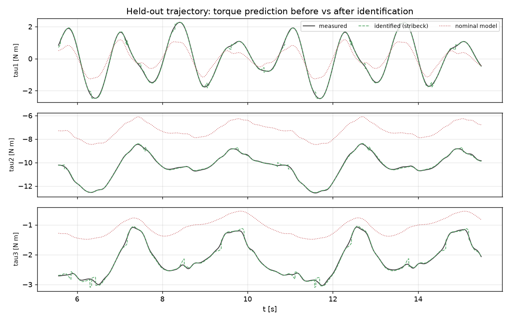
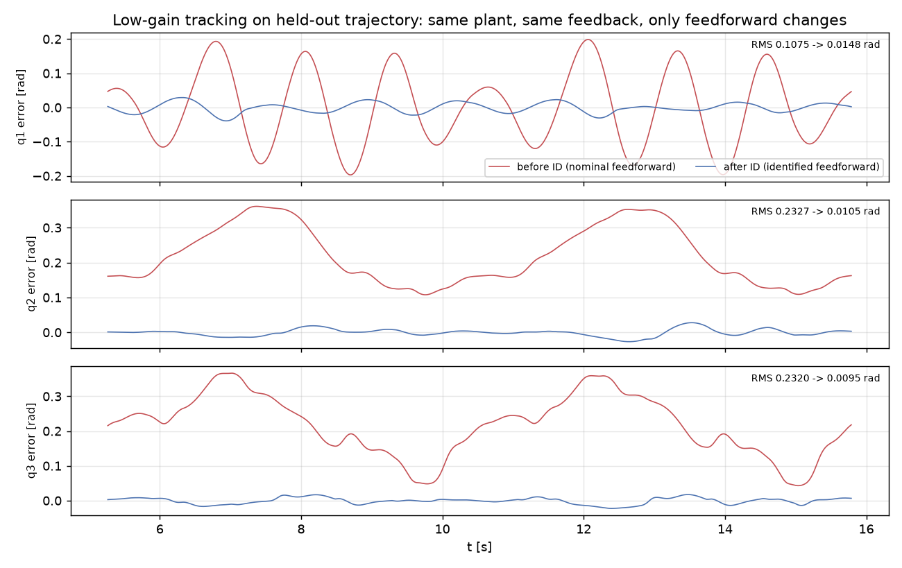
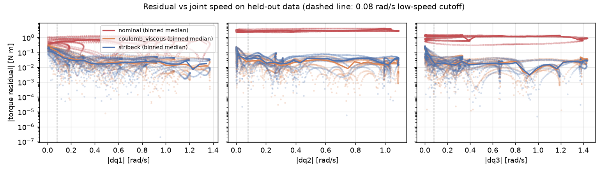
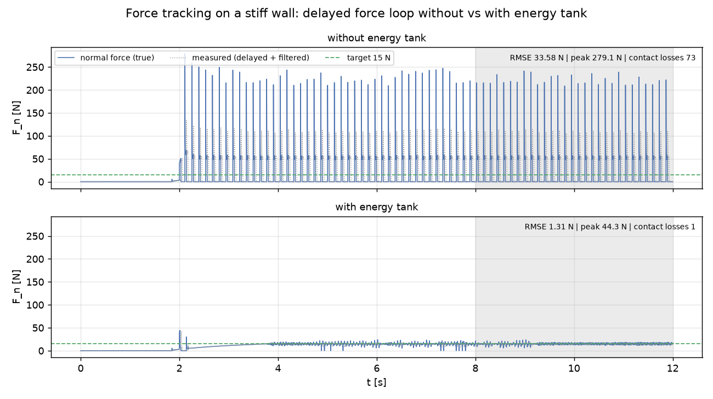
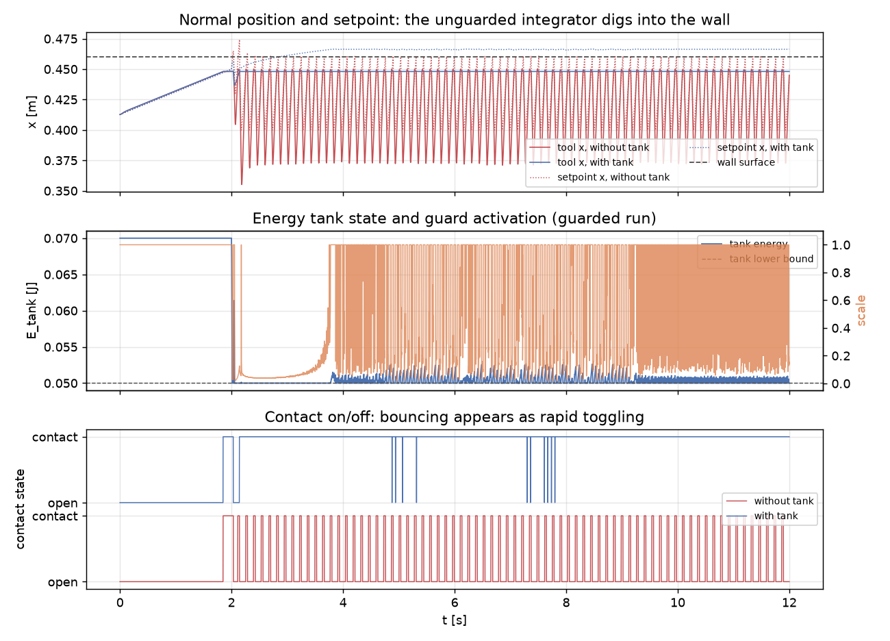
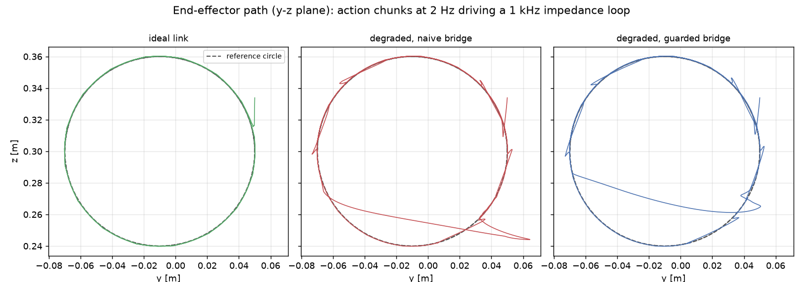
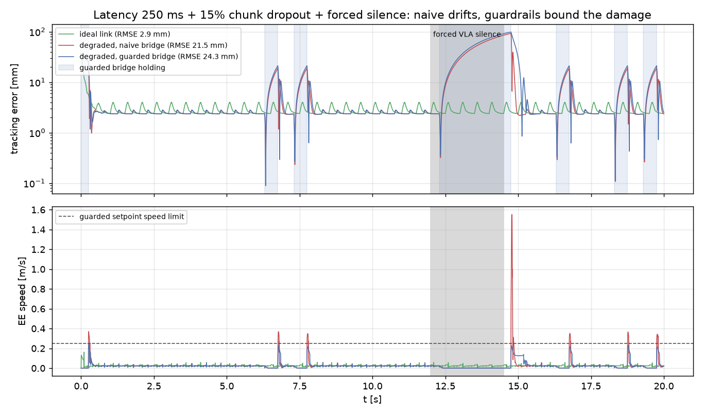

# 仿真演示：辨识 → 接触力控 → VLA 桥接

三个端到端演示，覆盖上肢/机械臂运动控制工程里常被问到的三件事：
辨识到底换来多少控制性能、力控失稳怎么发生怎么拦住、
学习策略的动作块怎么安全地接到千赫兹力矩环上。
全部基于本仓库的 RRR 机械臂与 MuJoCo 仿真栈，确定种子、一条命令复现：

```bash
python -m pip install -e ".[sim,ident,viz]"

robot-demo-hardware-id --output-dir artifacts/hardware_id
robot-demo-contact    --output-dir artifacts/contact_safety
robot-demo-vla        --output-dir artifacts/vla_bridge
```

产物（`metrics.json` + PNG）保存在 [artifacts/](../artifacts/README.md)。
以下数字来自默认参数与种子 0；控制器参数是演示假设，未经实机标定。

---

## 演示 1：仿真"实机"辨识闭环——辨识前后各差多少

### 问题

动力学参数辨识常只报告"拟合残差很小"。这回答不了两个更实际的问题：
在**独立**轨迹上，辨识模型比名义 CAD 模型好多少？把辨识结果放回
**控制器前馈**，跟踪精度换来多少？本演示在一个带真实测量链的仿真对象上
给出闭环答案。

### 方法

对象是空间 3R 臂（MuJoCo），在名义模型之外叠加：惯性参数随机扰动、
粘性/库仑摩擦 + Stribeck 低速摩擦峰、执行器一阶滞后与限幅、17 位编码器
量化、力矩噪声/增益误差、通道延迟，以及名义模型完全不知道的
**0.6 kg 末端负载**。流程：

1. 随机搜索低条件数的傅里叶激励轨迹（训练与保留验证各一条，互相独立）；
2. 闭环采集 `(q, dq, tau)`，延迟补偿 → 零相位低通 → 去边缘 → 剔除低速样本；
3. 最小二乘辨识基参数，摩擦结构分别用 `coulomb_viscous` 与 `stribeck` 两种；
4. 在保留轨迹上对比开环力矩预测（名义 vs 辨识）；
5. 同一对象、同一反馈增益（故意调弱以暴露前馈质量），只把前馈参数从
   名义换成辨识值，对比跟踪误差。

入口：`robot-demo-hardware-id`；实现：`src/robot_model/demos/hardware_id.py`
（复用库内 `RealisticMujocoSource`、激励搜索与辨识管线，负载通过 `mjSpec`
焊接到对象侧）。

### 指标

开环力矩预测（保留轨迹有效样本，逐关节 RMSE，N·m）：

| 模型 | 关节 1 | 关节 2 | 关节 3 | 总体 |
| --- | --- | --- | --- | --- |
| 名义（CAD + 无摩擦 + 无负载） | 0.605 | 3.076 | 1.142 | 1.93 |
| 辨识 coulomb_viscous | 0.042 | 0.027 | 0.026 | 0.032 |
| 辨识 stribeck | 0.044 | 0.039 | 0.028 | 0.038 |

两种摩擦结构都把开环预测误差降低约 **98%**（25/25 与 22/22 基参数满秩，
训练条件数约 99 与 90）。弱反馈（0.4 倍增益）下的跟踪 RMS（rad）：

| 前馈 | 关节 1 | 关节 2 | 关节 3 |
| --- | --- | --- | --- |
| 名义参数 | 0.107 | 0.233 | 0.232 |
| 辨识参数 | 0.015 | 0.011 | 0.009 |

跟踪误差降低 **86–96%**——这就是"辨识换来的控制性能"。





### 失败分析

- **低速区仍是失配区**：残差-速度图（下）显示，|dq| 低于约 0.08 rad/s 时
  两种摩擦模型的残差中位数都明显抬升——`sign(dq)` 在过零附近本质上
  描述不了静摩擦/预滑动，Stribeck 项只能部分缓解。实机上这就是
  低速精加工任务仍需摩擦观测器或自适应补偿的原因。
- **含低速段的整段 RMSE 高于有效样本**（stribeck：0.053 vs 0.038 N·m 总体），
  报告辨识结果时必须说明评分区间。
- 跟踪对照里辨识前馈在换向瞬间仍留下小尖峰（摩擦过零），反馈增益弱化
  进一步放大了这一点。



---

## 演示 2：接触力控失稳回放——能量罐拦住接触弹跳

### 问题

抛光/打磨类任务要求在刚性表面上跟踪法向力。力传感延迟 + 导纳式力外环
积分增益偏高 + 硬接触，是现场常见的失稳三要素：接触弹跳极限环，
峰值力可达目标的十几倍。问题是：同一套"激进调参"，加一个能量罐
（energy tank）护栏能不能把失稳变成有界、可用的行为？

### 方法

RRR 工具端压在 x=0.46 m 的刚性墙上（`rrr_contact_scene.xml`，无切向摩擦
以隔离法向环机理），跟踪 15 N 法向力并做 0.2 Hz 横向"抛光"滑动。控制：

- 内环：1 kHz 任务空间阻抗（Kp=800 N/m，Kd=80 N·s/m）+ 无接触模型的
  名义重力补偿 + 力矩限幅；
- 外环：导纳式力跟踪，力误差积分进法向设定点；力测量含 30 ms 延迟、
  0.3 N 噪声与 60 Hz 低通；积分增益 0.04 m/(N·s) **故意调高**；
- 护栏：能量罐只核算法向设定点运动的注入功率 `F_spring·dx_d`，
  以小比例阻尼耗散 + 小额恒定预算回充；罐见底即冻结设定点推进
  （拉回方向吸收能量、始终放行）。

入口：`robot-demo-contact`；实现：`src/robot_model/demos/contact_safety.py`。

### 指标

评估窗 8–12 s（弹跳已充分发展），目标 15 N：

| 设置 | 力 RMSE (N) | 峰值力 (N) | 接触丢失次数(≥5 ms) | 护栏介入时间占比 |
| --- | --- | --- | --- | --- |
| 无能量罐 | 33.6 | 279 | 73 | — |
| 有能量罐 | **1.31** | **44.3** | **1** | 43% |

同一组增益、同一延迟：无护栏是 0→250 N 的持续弹跳；有护栏在初始
瞬态（峰值 44 N，一次弹开）耗尽罐后进入稳定跟踪，均值 14.6 N。





### 失败分析

- **失稳机理**：延迟使力反馈滞后半个弹跳周期，积分器在"已经离墙"时仍在
  加压、"已经深压"时仍在撤退——相位恰好供能。能量罐不消除相位滞后，
  只是不让这个主动源持续注能。
- **罐参数即安全预算**：罐初值决定首个失稳瞬态能跑多远（0.07 J 对应
  峰值 44 N；调到 0.3 J 峰值升至 110 N 量级）。恒定回充速率决定罐空后
  力跟踪恢复的快慢——设为 0 会把设定点永久冻结在失稳瞬间。
- **被删掉的真实问题**：early 版本在墙面留有摩擦时，横向滑动引发
  粘滑颤振（与滑速峰值同相的高频接触抖动），和本演示的延迟失稳叠加后
  无法归因。演示里将墙面设为无摩擦；实机抛光需要另行处理切向粘滑。
- 另一个实现陷阱：重力补偿若在**含接触的模型**上做逆动力学，会把墙的
  反力也"补偿"进来，等于主动往墙里压（本演示曾因此多出 ~75 N 恒定压力，
  见 `TaskSpaceArm` 的无接触副本注释）。

---

## 演示 3：VLA → 底层控制桥接——延迟与丢包下护栏的价值

### 问题

VLA/模仿学习策略以低频（约 1–10 Hz）输出动作块，真正驱动机械臂的是
千赫兹级的阻抗/力矩环。推理延迟、网络丢包、模型卡顿都会发生。
裸桥接（拿到什么执行什么、没数据就外推）会发生什么？
速度钳位 + 工作空间盒 + 超时保持三个护栏又能保住什么？

### 方法

"VLA 桩"不是真模型：2 Hz 输出 8 步、0.1 s 间隔的末端位置目标块，
目标从当前观测指数收敛到参考圆轨迹（半径 6 cm、周期 8 s）——
这正是 ACT/π0 一类分块策略的接口形态，便于以后换成真模型。
桥接层 1 kHz 按时间戳插值动作块，驱动任务空间阻抗环。三种场景：

1. **理想链路**：零延迟、零丢包（基线）；
2. **退化链路 + 裸桥接**：250 ms 延迟、15% 随机丢块、12–14.5 s 强制
   "模型沉默"；块耗尽后沿最后速度外推（乐观执行器）；
3. **退化链路 + 护栏**：同一扰动种子，加设定点速度钳位（0.25 m/s）、
   工作空间盒钳位、0.8 s 超时保持（hold-on-timeout）。

入口：`robot-demo-vla`；实现：`src/robot_model/demos/vla_bridge.py`。

### 指标

| 场景 | 跟踪 RMSE (mm) | 最大误差 (mm) | 末端峰值速度 (m/s) | 保持占比 | 越界占比 |
| --- | --- | --- | --- | --- | --- |
| 理想链路 | 2.9 | 4.0 | 0.16 | 0 | 0 |
| 退化 + 裸桥接 | 21.5 | 92.7 | **1.55** | 0 | 0 |
| 退化 + 护栏 | 24.3 | 98.5 | **0.24** | 26% | 0 |

链路退化让跟踪 RMSE 劣化约 7 倍（2.9 → 21.5 mm）——这部分**护栏救不回来**。
护栏的价值在安全包络：沉默结束瞬间，裸桥接把过期目标一步吞下，末端
冲到 1.55 m/s（超过限速 6 倍，实机上是一次危险的甩臂）；护栏版全程
压在 0.24 m/s 以内，沉默期间整齐保持，恢复期平滑收敛。





### 失败分析

- **护栏不是性能补丁**：护栏版 RMSE（24.3 mm）略差于裸桥接（21.5 mm）——
  保持意味着不追参考。它买到的是有界速度、有界空间和可预期的降级行为，
  这是接实机的前提，不是精度优化。
- **超时参数必须和链路时序匹配**：hold timeout 若小于块周期 + 延迟
  （本演示 0.5 + 0.25 s），健康链路也会被判为"断流"，桥接在正常运行中
  反复保持（早期版本 hold 占比 57%，修正后 26%）。
- **外推是最危险的默认值**：裸桥接的事故不在丢包期间（只是漂移），
  而在数据恢复瞬间——过期时间戳的目标与外推漂移的设定点相距 10 cm 量级，
  一步跳变直接转成速度尖峰。真机桥接对"恢复"路径的处理比对"丢失"更重要。

---

## 局限与下一步

- 三个演示都在 RRR 上完成以便秒级复现；辨识管线本身已支持 Franka
  （`robot-identify --robot franka`），接触与桥接演示扩到 7 轴需要加
  姿态子任务与零空间处理。
- 力/接触读数直接取自 MuJoCo 接触求解器（相当于理想腕部传感器 + 人工
  噪声/延迟），没有建模传感器安装刚度与温漂。
- 能量罐是时域无源性的工程化近似：按通道核算、比例回充，未给出形式化
  无源性证明；文献中的严格处理见 energy-tank/passivity-based control 相关工作。
